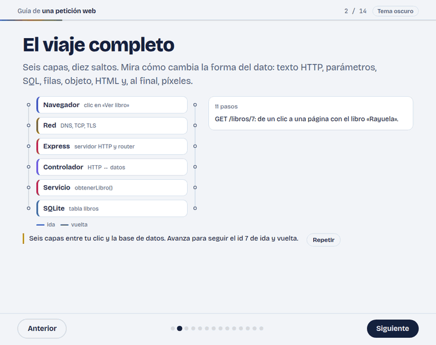
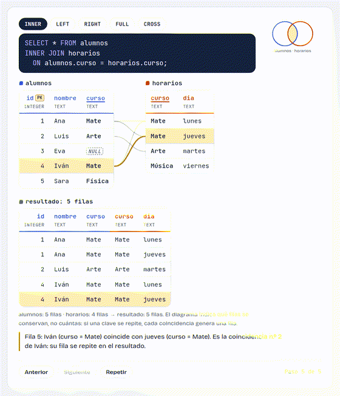

# tutorial-interactivo

Una skill para agentes de programación (Claude Code, opencode, Codex, Gemini CLI…) que convierte una pieza técnica en una **presentación HTML didáctica, animada e interactiva**. El agente explora tu proyecto, te pregunta solo lo que cambia el resultado, verifica cada dato ejecutándolo y elige visualizaciones según la forma de cada idea. El resultado es un único archivo HTML autocontenido: diapositivas, navegación con teclado y gestos, revelado paso a paso, tema claro y oscuro.

<picture>
  <source media="(prefers-color-scheme: dark)" srcset="docs/media/capas-oscuro.gif">
  
</picture>

**[Verlo en vivo](https://caertos.github.io/tutorial-interactivo/)**: [ejemplo «Cómo viaja una petición web»](https://caertos.github.io/tutorial-interactivo/assets/ejemplos/peticion-web.html) · [biblioteca de recursos visuales](https://caertos.github.io/tutorial-interactivo/assets/biblioteca.html)

## Qué puede enseñar

| Modo | Para | Ejemplo de petición |
|---|---|---|
| `api` | Función, método, clase, hook, componente, comando, endpoint, opción de configuración | «Enséñame a usar `Array.prototype.reduce`» |
| `datos` | Tablas, JOIN, GROUP BY, índices, cómo se ejecuta una consulta, esquemas | «Explícame cómo funciona un LEFT JOIN con mis tablas de pedidos» |
| `flujo` | Cómo viaja un dato o una petición por las capas de un sistema y vuelve | «Cómo llega una petición de mi app hasta la base de datos» |
| `concepto` | Bucle de eventos, referencias frente a valores, máquinas de estados, internos de git, algoritmos | «Cómo funciona por dentro el bucle de eventos de JavaScript» |

<picture>
  <source media="(prefers-color-scheme: dark)" srcset="docs/media/join-oscuro.gif">
  
</picture>

## Instalación

La skill es esta carpeta entera (`SKILL.md` + `assets/`, `references/`, `scripts/`). Clónala una vez y enlázala donde tu agente busca skills; para actualizar basta con `git pull`. El nombre del enlace debe ser `tutorial-interactivo`, igual que el `name` de `SKILL.md`.

```sh
git clone https://github.com/Caertos/tutorial-interactivo.git ~/src/tutorial-interactivo
```

| Agente | Personal (todos tus proyectos) | Por proyecto |
|---|---|---|
| Claude Code | `~/.claude/skills/tutorial-interactivo/` | `.claude/skills/tutorial-interactivo/` |
| opencode | `~/.config/opencode/skills/tutorial-interactivo/` (también lee `~/.claude/skills/` y `~/.agents/skills/`) | `.opencode/skills/`, `.claude/skills/` o `.agents/skills/` + `tutorial-interactivo/` |
| OpenAI Codex | `~/.agents/skills/tutorial-interactivo/` | `.agents/skills/tutorial-interactivo/` (desde la carpeta actual hasta la raíz del repositorio) |
| Gemini CLI | `~/.gemini/skills/tutorial-interactivo/` o `~/.agents/skills/tutorial-interactivo/` | `.gemini/skills/` o `.agents/skills/` + `tutorial-interactivo/` |
| Pi | `~/.pi/agent/skills/tutorial-interactivo/` o `~/.agents/skills/tutorial-interactivo/` | `.pi/skills/` o `.agents/skills/` + `tutorial-interactivo/` (solo en proyectos marcados como de confianza) |
| OpenClaw | `~/.openclaw/skills/tutorial-interactivo/` o `~/.agents/skills/tutorial-interactivo/` | `<workspace>/skills/` o `<workspace>/.agents/skills/` + `tutorial-interactivo/` |
| Hermes Agent | `~/.hermes/skills/tutorial-interactivo/` | — (o una carpeta propia en `skills.external_dirs`, ver abajo) |

Instalación personal con enlaces simbólicos:

```sh
# Claude Code (opencode también lee esta carpeta)
mkdir -p ~/.claude/skills && ln -s ~/src/tutorial-interactivo ~/.claude/skills/tutorial-interactivo

# Codex, Gemini CLI, opencode, Pi y OpenClaw leen ~/.agents/skills
mkdir -p ~/.agents/skills && ln -s ~/src/tutorial-interactivo ~/.agents/skills/tutorial-interactivo

# Hermes Agent
mkdir -p ~/.hermes/skills && ln -s ~/src/tutorial-interactivo ~/.hermes/skills/tutorial-interactivo
```

Un solo enlace en `~/.agents/skills/` sirve a la vez para Codex, Gemini CLI, opencode, Pi y OpenClaw.

Notas por agente:

- **Codex**: su documentación indica que sigue carpetas de skills enlazadas con symlink.
- **Gemini CLI**: también puedes instalar sin clonar a mano con `gemini skills install https://github.com/Caertos/tutorial-interactivo.git`, o enlazar el clon desde una sesión con `/skills link ~/src/tutorial-interactivo`. Comprueba con `gemini skills list`.
- **Pi**: busca `SKILL.md` de forma recursiva en sus carpetas de skills. Solo carga skills de proyecto (`.pi/skills/`, `.agents/skills/`) si el proyecto es de confianza. También puede leer carpetas de otros agentes (por ejemplo `~/.claude/skills`) si las añades al array `skills` de su configuración.
- **OpenClaw**: si el mismo nombre aparece en varias carpetas, gana la de mayor prioridad: `<workspace>/skills` → `<workspace>/.agents/skills` → `~/.agents/skills` → `~/.openclaw/skills` → skills incluidas → `skills.load.extraDirs`. `openclaw skills install` instala en el `skills/` del workspace; con `--global`, en `~/.openclaw/skills`. Ojo: no lee `$CODEX_HOME/skills`.
- **Hermes Agent**: `~/.hermes/skills/` es su carpeta principal; las subcarpetas de categoría son opcionales. Para no enlazar nada, puedes declarar el padre del clon en `~/.hermes/config.yaml`:

  ```yaml
  skills:
    external_dirs:
      - ~/.agents/skills
  ```

  También instala desde GitHub con `hermes skills install Caertos/tutorial-interactivo` (la skill está en la raíz del repositorio). Las skills nuevas se activan en la siguiente sesión, o con `/reset`.
- **Claude Code y opencode**: sus documentaciones dan las rutas pero no dicen nada sobre enlaces simbólicos. Si tu versión no los sigue, clona directamente en la ruta de la tabla (`git clone … ~/.claude/skills/tutorial-interactivo`) y actualiza con `git pull` allí.
- **Por proyecto**: clona o añade el repositorio como submódulo en la ruta de proyecto de la tabla y haz commit para compartirlo con tu equipo.

**Agentes sin soporte de skills** (Cursor, Copilot, Aider…): clona la carpeta y añade a su archivo de instrucciones (`AGENTS.md`, `.cursor/rules`, `.github/copilot-instructions.md`…) una regla como esta, con la ruta absoluta:

```md
Cuando pida un tutorial, una guía, una lección o una explicación de cómo funciona algo, lee
/ruta/a/tutorial-interactivo/SKILL.md y sigue su flujo de trabajo. `<skill>` en ese archivo es
/ruta/a/tutorial-interactivo.
```

## Uso

Pídelo con naturalidad; no hace falta decir «presentación» ni «HTML»:

- «Explícame cómo funciona `useEffect` y cuándo se ejecuta la limpieza»
- «Cómo viaja una petición en mi app desde el formulario de login hasta la tabla `users`»
- «Hazme un tutorial de `git rebase` para alguien que solo sabe `merge`»
- «Diagrama de cómo se ejecuta un `GROUP BY` con `HAVING`»
- «Teach me how to use `fetch` with `AbortController`» (la presentación va en el idioma de la petición)

**La ronda de preguntas.** Antes de investigar, el agente hace una única ronda de preguntas de opción múltiple, solo sobre lo que no puede deducir de tu proyecto: modo si es ambiguo, si quieres un ejemplo análogo o tu caso real, nivel, dialecto o stack, énfasis visual. La opción recomendada va primero. Más adelante solo vuelve a preguntar si aparece algo que cambia el resultado (el esquema contradice la petición, hay dos flujos posibles…); lo demás lo decide y lo anota como suposición en la portada.

**Dónde queda.** En un proyecto: `tutors/<unidad>.html` en la raíz del repositorio (con su carpeta de trabajo `tutors/<unidad>/`: ficha con fuentes, datos verificados y capturas) y `tutors/` añadido al `.gitignore`. Sin proyecto: `tutors/<unidad>.html` en la carpeta actual. El agente no hace commit ni push.

**Elegir visualizaciones.** Abre `assets/biblioteca.html` en el navegador: muestra cada módulo en vivo, paso a paso, con su código y todas sus opciones. Puedes pedir uno por su nombre: «usa `linea-tiempo` para comparar SSR y CSR» o «muestra el JOIN con el módulo `join`».

## Cómo funciona

```text
explorar → preguntar → investigar y verificar → ficha → plan visual → build → validar
```

1. **Explorar**: detecta lenguaje, framework y versión exacta (lockfile), dialecto SQL y esquema, y la ruta real del dato en tu código. Lo que se puede deducir no se pregunta.
2. **Preguntar**: una ronda de opción múltiple con la recomendada primero.
3. **Investigar y verificar**: lee la referencia oficial de la versión detectada y **ejecuta** todo resultado que vaya a mostrar (SQL con `sqlite3`, JS con `node`, git en un repositorio desechable). Lo que no puede confirmar se marca «no confirmado».
4. **Ficha**: `tutors/<unidad>/ficha.md` con datos técnicos, preguntas, suposiciones y resultados reales. Toda afirmación de la presentación se rastrea hasta ella.
5. **Plan visual**: clasifica la forma de cada idea (transformación, datos tabulares, flujo entre capas…) y elige el recurso mínimo que la explica, o ninguno.
6. **Build**: `scripts/build.py` inserta el núcleo y solo los módulos usados en un único HTML autocontenido.
7. **Validar**: `scripts/validate.py` comprueba configuraciones, accesibilidad y recursos remotos, y toma capturas de cada diapositiva y de cada paso intermedio, en móvil y escritorio, claro y oscuro. El agente mira las capturas antes de entregar.

## Módulos visuales

Cada módulo es una visualización configurable por JSON que el build incluye solo si el tutorial la usa. La tabla se genera desde `assets/viz/*/meta.json`.

<!-- modulos:inicio -->
<!-- GENERATED by scripts/build_biblioteca.py from assets/viz/*/meta.json; edit those and rerun. -->

| Grupo | Módulo | Qué muestra | Forma |
|---|---|---|---|
| Datos y consultas | `tabla` | Tabla de datos paso a paso | datos tabulares, filtrado, columna calculada, SQL, dataframe |
|  | `join` | JOIN entre dos tablas | SQL, combinación, claves, dataframe merge |
|  | `orden-sql` | Orden lógico de una consulta SQL | SQL, pipeline, orden de ejecución, agregación |
| Cantidades y comparaciones | `grafico` | Gráfico de barras, líneas o dispersión | cantidades, comparación, agregación, SQL, tendencia |
|  | `antes-despues` | Antes y después | comparación, diferencias, inmutabilidad, transformación |
| Ejecución y tiempo | `maquina` | Máquina de entrada y salida | transformación, entrada-salida, función pura |
|  | `traza` | Traza de ejecución | iteración, secuencia, acumulación |
|  | `linea-tiempo` | Línea de tiempo y colas | tiempo, concurrencia, colas, ciclo de vida |
|  | `memoria` | Pila, montículo y referencias | referencias, memoria, mutación, copia |
| Flujos entre partes | `capas` | Flujo de datos entre capas | flujo entre capas, petición-respuesta, transformación, arquitectura |
|  | `secuencia` | Diagrama de secuencia | secuencia, petición-respuesta, protocolo, actores |
|  | `estado` | Máquina de estados | estados, eventos, ciclo de vida, protocolo |
| Estructuras | `arbol` | Árbol y recorridos | árbol, jerarquía, recorrido, búsqueda |
|  | `grafo` | Grafo dirigido e historial de git | grafo, dependencias, git, orden de ejecución |
|  | `cuadricula` | Arreglo o matriz con punteros | arreglo, punteros, algoritmo, matriz |
<!-- modulos:fin -->

Además hay 10 componentes del núcleo (portada, código con notas, ficha de parámetro, retorno, tabla de casos, «Predice el resultado», avisos, playground, puente, resumen) en `assets/core/componentes/`.

## Extenderla

Para añadir un módulo:

1. Crea `assets/viz/<nombre>/` con `viz.js` (una llamada a `Viz.register`), `viz.css`, `meta.json` (`name`, `titulo`, `forma`, `cuando`, `cuandoNo`, `config` con **todas** las opciones) y `demo.html` (un ejemplo realista).
2. Añádelo a un grupo en `GROUPS` de `scripts/build_biblioteca.py`.
3. Regenera la galería, el catálogo del agente y la tabla de este README: `python3 scripts/build_biblioteca.py`.
4. Valida y mira las capturas: `python3 scripts/validate.py assets/biblioteca.html --screenshots /tmp/capturas --alto 5200`.

El contrato completo (API, pasos, reglas de diseño, lista de comprobación) está en [`assets/viz/README.md`](assets/viz/README.md); las reglas visuales, en [`references/diseno.md`](references/diseno.md).

```text
SKILL.md                 flujo de trabajo que sigue el agente
references/              investigación, pedagogía, diseño y catálogo (generado)
assets/core/             motor (engine.js, engine.css) y componentes
assets/viz/<nombre>/     módulos visuales
assets/esqueleto.html    punto de partida de cada presentación
assets/biblioteca.html   galería (generada)
assets/ejemplos/         presentación de ejemplo ya compilada
scripts/                 build.py, validate.py, build_biblioteca.py
```

## Verlo en vivo con GitHub Pages

GitHub no ejecuta scripts dentro del README, así que las animaciones de arriba son GIF. La versión real está publicada con GitHub Pages:

- <https://caertos.github.io/tutorial-interactivo/> — portada con enlaces (`index.html`)
- <https://caertos.github.io/tutorial-interactivo/assets/ejemplos/peticion-web.html> — ejemplo «Cómo viaja una petición web»
- <https://caertos.github.io/tutorial-interactivo/assets/biblioteca.html> — biblioteca de recursos visuales

El despliegue usa **Deploy from a branch**: rama `main`, carpeta **`/ (root)`**. Para republicar, haz push a `main`; Pages reconstruye el sitio automáticamente.

Los archivos son autocontenidos (solo cargan Google Fonts), así que también funcionan descargados y abiertos con doble clic.

## Requisitos

- **Python 3** (solo biblioteca estándar) para `build.py`, `validate.py` y `build_biblioteca.py`.
- **Google Chrome o Chromium** (opcional): capturas de validación en modo headless. Sin él, la validación estructural funciona igual y se omiten las capturas.
- **sqlite3** (opcional): verificar consultas en el modo `datos`. `node`, `duckdb` o `psql` según el tema, si están disponibles.

## Licencia

[MIT](LICENSE) © 2026 Caertos.

## Fuentes de las rutas de instalación

Consultadas el 19 de octubre de 2026:

- Claude Code: <https://code.claude.com/docs/en/skills>
- opencode: <https://opencode.ai/docs/skills/>
- OpenAI Codex: <https://developers.openai.com/codex/skills> (redirige a <https://learn.chatgpt.com/docs/build-skills>)
- Gemini CLI: <https://geminicli.com/docs/cli/skills/>
- Pi: documentación `docs/skills.md` del paquete `@earendil-works/pi-coding-agent` (<https://unpkg.com/@earendil-works/pi-coding-agent@0.80.9/docs/skills.md>)
- OpenClaw: <https://docs.openclaw.ai/tools/skills>
- Hermes Agent: <https://hermes-agent.nousresearch.com/docs/user-guide/features/skills>
